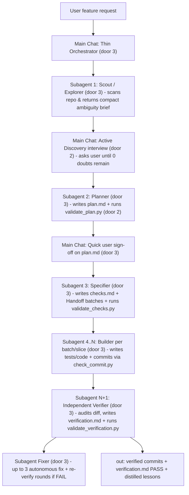

# Software Factory Skill (`software-factory`)

## Problem

Developers using AI coding agents across Antigravity, Claude Code, and Codex currently rely on `tlc-spec-lean`, which suffers from four limitations for end-to-end autonomous feature delivery:
1. **Context window bloat in single-session execution**: when one agent session explores the codebase, interviews the user, writes `plan.md`, derives `checks.md`, writes tests and code, and coordinates verification, the main chat context fills up, triggering lossy compaction and degraded reasoning.
2. **Third-party coupling**: it is coupled to external naming (`tlc-spec-lean`, Tech Leads Club references) rather than a generic software-factory identity.
3. **Passive requirements discovery**: its planning phase encourages silently logging unconfirmed defaults (`Confirmed? n`) instead of closing 100% of product and scope doubts with the user.
4. **Manual phase transitions**: it requires manual prompting between `plan`, `checks`, `build`, and `verify`, lacking a phase-by-phase multi-agent dispatcher (`orchestrate.py`) across Antigravity, Claude Code, and Codex.

When this ships, the main chat acts strictly as a **thin Orchestrator** (keeping its context window minimal) that delegates every heavy phase (`Scout -> Planner -> Specifier/Checks -> Builder [per batch] -> Verifier -> Fixer`) to fresh, isolated subagents communicating exclusively through on-disk `.specs/` artifacts and git commits.

## Flow

Reuses the existing deterministic gate scripts (`validate_plan.py`, `validate_checks.py`, `validate_verification.py`, `check_commit.py`, `lessons.py`, `selftest.py`) and repository validator (`scripts/validate.py`).

## Impact

| Front | What changes |
| --- | --- |
| domain | existing term: `tlc-spec-lean` meant the third-party curated spec skill, now replaced by `software-factory` across `skills/`, `registry.json`, `plugin.json`, and `README.md` |
| domain | new term: `Thin Orchestrator` - the main chat session that never reads the codebase or writes implementation code directly, delegating each phase to a fresh subagent to keep main context under ~15k tokens, lives in `SKILL.md` and `references/orchestration.md` |
| domain | new term: `DISCOVER phase` - active requirements interview phase backed by a read-only Scout subagent and a strict gate forbidding unconfirmed assumptions (`Confirmed? n`), lives in `references/discovery.md` and `validate_plan.py` |
| domain | new term: `Phase Subagents` (`scout`, `planner`, `specifier`, `builder`, `verifier`, `fixer`) - isolated ephemeral workers invoked via native subagent tools or `scripts/orchestrate.py`, lives in `references/orchestration.md` and `scripts/orchestrate.py` |
| stored data | migrate existing `skills/tlc-spec-lean/` directory to `skills/software-factory/` and update references in `registry.json`, `plugin.json`, and `README.md` |

## Relations

None - no stored-data shape change

## Surface

None - nothing consumed outside

## Landing

| One-way door | Literal shape | Alternative rejected |
| --- | --- | --- |
| Unified skill directory and identifier | `skills/software-factory/SKILL.md` with `name: software-factory` and zero `tlc` / `Tech Leads Club` references (door 1) | Keeping `tlc-spec-lean` alongside a second skill, which splits the workflow across two skills and preserves external branding |
| Active Discovery closure gate in `validate_plan.py` | `Confirmed?` column in `## Assumptions` must be `y` for every row; `n` fails `validate_plan.py` with an error (door 2) | Allowing `Confirmed? n` in `plan.md`, which lets the agent guess product behavior without user confirmation |
| Thin-Orchestrator subagent-per-phase architecture | Main chat delegates `scout`, `planner`, `specifier`, `builder` (1 per slice/batch), `verifier`, and `fixer` to fresh subagents that pass state via `.specs/features/<feature>/` files on disk (door 3) | Running Discovery, Planning, Checks, and Build inside the main chat context, which bloats the context window and causes compaction loss |
| Deterministic hybrid orchestrator CLI | `skills/software-factory/scripts/orchestrate.py` with subcommands `status`, `prompt` (`--role [scout\|planner\|specifier\|builder\|verifier\|fixer]`), `gate`, and `dispatch` (`--agent [antigravity\|claude\|codex]`) (door 4) | Relying solely on markdown instructions without a script, leaving CLI/headless environments without deterministic prompt isolation or pipeline state inspection |

- Nothing else in this change is hard to reverse

## Criteria

Grouped by slice - one observable outcome each, never a layer.

### S1: Rebrand and Unify into `software-factory` (P1)

The skill is unified under `skills/software-factory/` with all Tech Leads Club references removed and repository manifests updated.

**Acceptance Criteria**

1. The system SHALL provide `skills/software-factory/SKILL.md` with frontmatter `name: software-factory` and remove `skills/tlc-spec-lean/`.
2. The system SHALL contain zero occurrences of `tlc-spec-lean`, `Tech Leads Club`, `tech-leads-club`, or `Felipe Rodrigues` across `skills/software-factory/`, `registry.json`, `plugin.json`, and `README.md`.
3. WHEN `python scripts/validate.py --root .` runs THEN the system SHALL exit with code 0 and validate `software-factory` in `skills/`, `registry.json`, and `plugin.json`.

**Independent test:** Run `python scripts/validate.py --root .` and search the repository for `tlc-spec-lean` or `Tech Leads Club`.

### S2: Active Discovery Phase and Confirmed-Scope Gate (P1)

The skill uses a Scout subagent to inspect the repo without polluting the main chat, conducts structured discovery questions with the user, and enforces that no unconfirmed assumptions pass the plan gate.

**Acceptance Criteria**

4. The system SHALL provide `skills/software-factory/references/discovery.md` defining the Scout subagent handoff, the 5-stage flow (`DISCOVER -> PLAN -> CHECKS -> BUILD -> VERIFY`), and structured questioning rules across `Observable` surfaces and the 9 implicit dimensions.
5. IF an assumption row in `plan.md` has `Confirmed?` set to `n` or blank THEN `validate_plan.py` SHALL exit with code 1 and report an unconfirmed assumption error.
6. WHEN all assumption rows in `plan.md` have `Confirmed?` set to `y` and all structural checks pass THEN `validate_plan.py` SHALL exit with code 0.

**Independent test:** Run `validate_plan.py` against a plan containing `Confirmed? | n` and assert exit code 1, then with `Confirmed? | y` and assert exit code 0.

### S3: Subagent-per-Phase Hybrid Orchestration (`orchestrate.py` + `orchestration.md`) (P1)

Every heavy phase (`scout`, `planner`, `specifier`, `builder`, `verifier`, `fixer`) runs in a fresh subagent context across Antigravity, Claude Code, and Codex, keeping the main chat as a thin orchestrator.

**Acceptance Criteria**

7. The system SHALL provide `skills/software-factory/references/orchestration.md` specifying the Thin-Orchestrator rules, context-window budget rules, autonomous post-plan execution loop, and native subagent dispatch mappings for Antigravity (`invoke_subagent`), Claude Code (`Task`), and Codex across all 6 roles (`scout`, `planner`, `specifier`, `builder`, `verifier`, `fixer`).
8. WHEN `orchestrate.py status <feature> --root <dir>` runs THEN the script SHALL output the current pipeline phase (`discover`, `plan`, `checks`, `build`, `verify`, `fix`, or `done`) and next recommended subagent role, and exit with code 0.
9. WHEN `orchestrate.py prompt <feature> --role <scout|planner|specifier|builder|verifier|fixer> --root <dir>` runs THEN the script SHALL generate a self-contained, context-isolated prompt for that role referencing only on-disk `.specs/features/<feature>/` artifacts and git state, and exit with code 0.
10. WHEN `orchestrate.py gate <feature> --phase <plan|checks|verify> --root <dir>` runs THEN the script SHALL execute the corresponding validator script and propagate its exit code (`0`, `1`, or `2`).
11. IF `orchestrate.py dispatch <feature> --role <scout|planner|specifier|builder|verifier|fixer>` is called with `--dry-run` and `--agent <antigravity|claude|codex>` THEN the script SHALL print the exact CLI command and isolated prompt for that target agent and exit with code 0.
12. WHEN `skills/software-factory/scripts/selftest.py` runs THEN the script SHALL execute all baseline, fault-injection, negative-control, and tooling checks (including `orchestrate.py` over all 6 subagent roles and the unconfirmed-assumption mutant) and exit with code 0.

**Independent test:** Run `python skills/software-factory/scripts/selftest.py` and `python -m unittest discover -s tests` and confirm both exit 0.

## Out of scope

Product capabilities only.

| Excluded | Why |
| --- | --- |
| Cloud-hosted daemon or webhook server for background execution | The skill operates locally inside the developer's IDE chat or terminal CLI |
| Automatic `git push` or deployment after `VERIFY` passes | Blast-radius rule preserves local-only commits unless the user explicitly authorizes pushing |

## Assumptions

| Assumption | Chosen default | Rationale | Confirmed? |
| --- | --- | --- | --- |
| Skill architecture | Single unified skill named `software-factory` replacing `tlc-spec-lean` | User explicitly selected unifying into `software-factory` | y |
| Discovery behavior | Active Discovery phase (`DISCOVER -> PLAN -> CHECKS -> BUILD -> VERIFY`) requiring all scope doubts to be asked and confirmed before `plan.md` approval | User explicitly chose active Discovery to close scope with zero doubts | y |
| Human approval boundary | Quick sign-off on `plan.md`, followed by 100% autonomous execution of `Checks -> Build -> Verify (and Fix loops)` | User explicitly selected quick approval of `plan.md` then autonomous execution | y |
| Context-window protection | Thin-Orchestrator pattern: main chat delegates every heavy phase (`scout`, `planner`, `specifier`, `builder`, `verifier`, `fixer`) to isolated subagents via `.specs/` files on disk | User raised context-window concern; subagent-per-phase prevents main chat bloat | y |

**Open questions:** none - all resolved or logged above.

## Observable

Worksheet of surface decisions.

| Surface | Decision | Landing |
| --- | --- | --- |
| CLI `scripts/orchestrate.py` | subcommands (`status`, `prompt`, `gate`, `dispatch`), all 6 subagent roles, flags, and exit codes | AC 8, AC 9, AC 10, AC 11 |
| CLI `scripts/validate_plan.py` | rejection of unconfirmed assumptions (`Confirmed? n`) | AC 5, AC 6 |
| CLI `scripts/selftest.py` | self-test of all validators and `orchestrate.py` | AC 12 |
| Document `SKILL.md` & `references/` | Thin-Orchestrator subagent-per-phase architecture, 5-phase flow, and multi-agent mappings | AC 1, AC 2, AC 4, AC 7 |
| screen | UI states | n/a - this feature is a CLI and markdown agent skill with no graphical screen |

## Sources

- User request and confirmed Discovery decisions (17 Oct 2026) - settles `software-factory` unification, active `DISCOVER` phase, `plan.md` approval boundary, and subagent-per-phase context isolation
